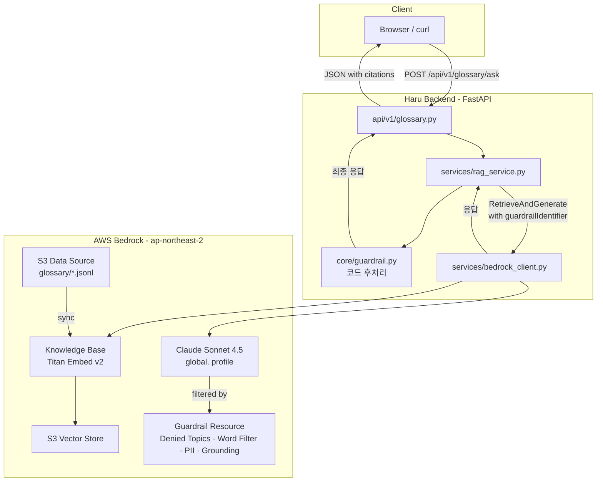
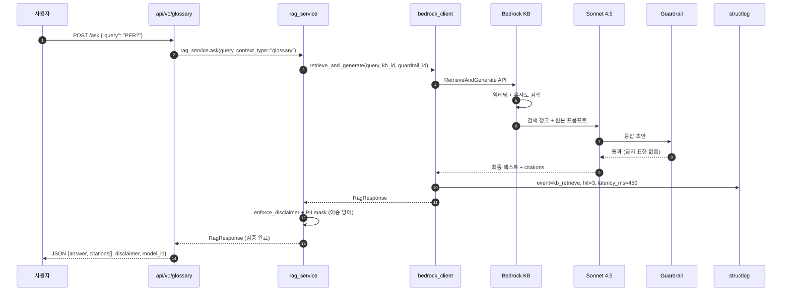
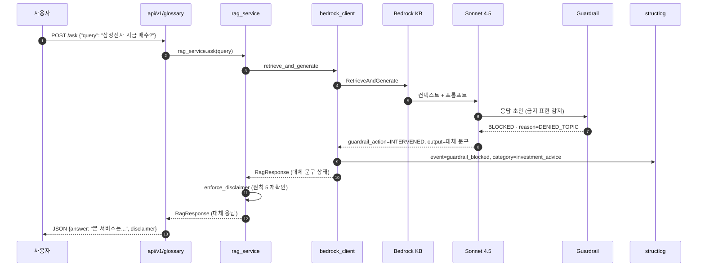

# Design — Bedrock Knowledge Base & Guardrail 실물화

## Overview

이 스펙은 두 개의 상위 AWS 리소스(**Bedrock Knowledge Base**, **Bedrock Guardrail**)를 신설하고, 기존 Haru 백엔드의 `services/rag_service.py`·`core/guardrail.py`가 이 리소스를 활용하도록 확장한다. 코드 차원의 후처리 가드는 그대로 유지하여 **이중 방어**를 실현한다.

## 하이 레벨 아키텍처



## 시퀀스 다이어그램 — 정상 응답 (US-1)



## 시퀀스 다이어그램 — Guardrail 차단 (US-2)



## 컴포넌트 설계

### 1. `services/bedrock_client.py` (확장)

```python
class BedrockClient:
    def __init__(self, settings: Settings) -> None:
        self._runtime = boto3.client("bedrock-runtime", region_name=settings.aws_region)
        self._agent_runtime = boto3.client("bedrock-agent-runtime", region_name=settings.aws_region)
        self._agent = boto3.client("bedrock-agent", region_name=settings.aws_region)
        self._settings = settings

    def retrieve_and_generate(
        self,
        query: str,
        kb_id: str,
        guardrail_id: str | None,
        guardrail_version: str = "DRAFT",
        context_type: Literal["glossary", "stock", "general"] = "general",
    ) -> RetrieveGenerateResult: ...

    def start_kb_sync(self, kb_id: str, data_source_id: str) -> str: ...
    def poll_kb_sync(self, kb_id: str, ingestion_job_id: str, timeout_s: int = 600) -> str: ...
```

- 클라이언트는 앱 라이프사이클당 1개, 팩토리 재사용
- 타임아웃 30초 (retrieve_and_generate), 백오프 재시도 최대 3회
- 예외는 `BedrockRetrievalError`, `BedrockGuardrailBlockedError`, `BedrockNotAvailableError`로 세분화

### 2. `services/rag_service.py` (수정)

```python
class RagService:
    def ask(
        self,
        query: str,
        context_type: Literal["glossary", "stock", "general"] = "general",
    ) -> RagResponse:
        if not self._settings.bedrock_kb_id:
            return self._mock_response(query, context_type)
        raw = self._bedrock.retrieve_and_generate(...)
        if raw.similarity_max < 0.5 and context_type == "stock":
            return self._no_grounding_response(query)  # REQ-RAG-04
        return self._post_process(raw, context_type)
```

- `_post_process`는 `enforce_disclaimer`, `mask_pii`, 금지 표현 검출 순으로 실행
- Bedrock Guardrail이 이미 차단한 경우도 재검증 (이중 방어)

### 3. `core/guardrail.py` (기존 유지 + 확장)

- 기존 함수(`has_forbidden_phrase`, `enforce_disclaimer`, `mask_pii`) 그대로 유지
- 신규 함수:
  - `is_bedrock_guardrail_blocked(response: dict) -> bool`
  - `extract_blocked_categories(response: dict) -> list[str]`

### 4. `models/rag.py` (확장)

```python
class RagCitation(BaseModel):
    text_snippet: str
    source_uri: str
    similarity: float

class RagResponse(BaseModel):
    answer: str
    citations: list[RagCitation]  # 최소 0개 (glossary는 1개+ 강제)
    disclaimer: str  # 원칙 5, 절대 빈 문자열 금지
    model_id: str
    context_type: Literal["glossary", "stock", "general"]
    summary_source: Literal["bedrock", "template", "cached_bedrock", "general_knowledge"]
    guardrail_action: Literal["none", "intervened"] | None = None
    is_mock: bool = False
```

### 5. `api/v1/glossary.py` (신설)

```python
@router.post("/ask", response_model=RagResponse)
async def ask_glossary(body: GlossaryAskRequest, svc: RagService = Depends()) -> RagResponse:
    return svc.ask(body.query, context_type="glossary")
```

### 6. `api/v1/admin.py` (신설, 인증 없이 read-only)

```python
@router.get("/kb-status", response_model=KbStatusResponse)
async def kb_status(svc: KbAdminService = Depends()) -> KbStatusResponse:
    return svc.get_status()
```

### 7. `scripts/kb/upload_glossary.py` (신설)

- jutopia_data의 `glossary.json`을 JSONL로 변환 후 S3에 업로드
- 각 라인: `{"term": "PER", "definition": "...", "category": "...", "formula": "..."}`
- HITL 승인 필요 (S3 write)

### 8. `scripts/kb/create_or_sync_kb.py` (신설)

- KB 부재 시 생성, 존재 시 데이터 소스 sync 트리거
- 완료까지 폴링 (최대 10분)
- HITL 승인 필요 (KB 리소스 생성)

### 9. `scripts/guardrail/create_guardrail.py` (신설)

- REQ-GR-01의 6개 정책 등록
- 버전 DRAFT 생성, 사용자 승인 후 v1 게시
- HITL 승인 필요 (Guardrail 리소스 생성)

### 10. `app/config.py` (수정)

```python
class Settings(BaseSettings):
    app_env: Literal["local", "dev", "staging", "prod"] = "local"
    # ... 기존 필드 ...
    bedrock_kb_id: str = ""
    bedrock_guardrail_id: str = ""
    bedrock_guardrail_version: str = "DRAFT"
    haru_kb_s3_bucket: str = ""
    haru_kb_s3_vector_index_arn: str = ""

    @model_validator(mode="after")
    def _prod_requires_bedrock_ids(self) -> "Settings":
        if self.app_env == "prod":
            missing = [k for k in ("bedrock_kb_id", "bedrock_guardrail_id",
                                    "haru_kb_s3_bucket") if not getattr(self, k)]
            if missing:
                raise ValueError(f"prod requires: {missing}")
        return self
```

## 데이터 모델

### KB 청크 (S3 JSONL 라인)

```json
{
  "id": "glossary_per",
  "term": "PER",
  "definition": "주가수익비율. 주가 ÷ 주당순이익.",
  "category": "밸류에이션",
  "related_terms": ["PBR", "EPS"],
  "formula": "PER = Price / EPS",
  "source": "Haru glossary v1"
}
```

### Guardrail 정책 정의 (Python dict → boto3 kwargs)

```python
GUARDRAIL_CONFIG = {
  "name": "haru-investment-guardrail",
  "topicPolicyConfig": {
    "topicsConfig": [
      {
        "name": "investment-advice",
        "definition": "특정 종목의 매수·매도 권유 또는 미래 가격 예측",
        "examples": [
          "이 종목을 매수하세요",
          "○○원까지 오를 것",
          "내일 급등할 종목"
        ],
        "type": "DENY"
      },
      ...
    ]
  },
  "wordPolicyConfig": {
    "wordsConfig": [
      {"text": "리딩방"},
      {"text": "한 방"},
      {"text": "무조건 수익"},
      {"text": "보장"}
    ]
  },
  "sensitiveInformationPolicyConfig": {
    "piiEntitiesConfig": [
      {"type": "KR_RRN", "action": "ANONYMIZE"},
      ...
    ]
  },
  "contentPolicyConfig": {...},
  "contextualGroundingPolicyConfig": {
    "filtersConfig": [
      {"type": "GROUNDING", "threshold": 0.75, "action": "BLOCK"}
    ]
  },
  "blockedInputMessaging": "본 서비스는 종목 추천을 제공하지 않습니다.",
  "blockedOutputsMessaging": "본 정보는 투자 판단의 보조이며, 최종 결정은 사용자에게 있습니다."
}
```

## 인터페이스 계약

### `POST /api/v1/glossary/ask`

**Request**:
```json
{"query": "PER이 뭐야?"}
```

**Response 200** (정상):
```json
{
  "answer": "PER은 주가수익비율입니다...",
  "citations": [
    {"text_snippet": "PER = Price / EPS", "source_uri": "s3://haru-kb/glossary/per.jsonl", "similarity": 0.87}
  ],
  "disclaimer": "본 정보는 투자 판단의 보조이며, 최종 결정은 사용자에게 있습니다.",
  "model_id": "global.anthropic.claude-sonnet-4-5-v1:0",
  "context_type": "glossary",
  "summary_source": "bedrock",
  "guardrail_action": "none",
  "is_mock": false
}
```

**Response 200** (Guardrail 차단):
```json
{
  "answer": "본 서비스는 종목 추천을 제공하지 않습니다. 판단은 본인에게 있습니다.",
  "citations": [],
  "disclaimer": "본 정보는 투자 판단의 보조이며, 최종 결정은 사용자에게 있습니다.",
  "model_id": "global.anthropic.claude-sonnet-4-5-v1:0",
  "context_type": "glossary",
  "summary_source": "template",
  "guardrail_action": "intervened",
  "is_mock": false
}
```

**Response 502** (Bedrock 장애):
```json
{"detail": "Bedrock temporarily unavailable"}
```

## 하네스 (실행 환경 제어) 설계

각 태스크 실행 시 Kiro가 지켜야 할 실행 규칙:

| 대상 | 타임아웃 | 재시도 | HITL 승인 |
|---|---|---|---|
| pytest 실행 | 5분 | 0 | Allow Once |
| ruff/black | 30초 | 0 | Allow Session |
| boto3 read-only (list*, get*) | 30초 | 2 | Allow Once |
| boto3 create/update/delete | 60초 | 0 | **필수 승인** |
| S3 write | 60초 | 1 | **필수 승인** |
| Guardrail 리소스 생성 | 120초 | 0 | **필수 승인** |
| KB 생성·sync | 600초 | 0 | **필수 승인** |
| `.env` 편집 | — | — | **필수 승인 + 값 노출 금지** |

## 관측성 로그 스키마

```json
{"event":"kb_retrieve","kb_id":"...","query_hash":"sha256:...","hit_count":3,"avg_similarity":0.76,"latency_ms":450}
{"event":"guardrail_blocked","guardrail_id":"...","category":"investment_advice","reason":"DENIED_TOPIC","masked_query":"삼성전자..."}
{"event":"bedrock_call","service":"bedrock-agent-runtime","operation":"RetrieveAndGenerate","status":"success","latency_ms":890,"tokens_in":234,"tokens_out":167}
```

## 테스트 전략

### Unit (`tests/unit/`)

- `test_config_prod_requires_kb_id` — REQ-ENV-01
- `test_config_local_allows_empty_kb_id` — REQ-ENV-02
- `test_rag_response_disclaimer_always_present` — 원칙 5
- `test_guardrail_word_filter_variants` — 원칙 1

### Integration (`tests/integration/`)

- `test_glossary_ask_mock_mode` — KB 미설정 시 mock 응답
- `test_glossary_ask_with_fake_bedrock` — Fake KB 응답 주입, citations 검증
- `test_kb_sync_polling_timeout` — 폴링 로직 mock

### Regression (`tests/regression/`)

- `test_investment_advice_blocked_by_bedrock_guardrail` — Fake Guardrail이 `intervened` 반환하면 코드가 표준 대체 문구로 응답
- `test_bedrock_guardrail_blocked_still_has_disclaimer` — Guardrail 차단 응답에도 disclaimer 포함
- `test_stock_context_no_grounding_returns_alt_message` — REQ-RAG-04
- `test_guardrail_and_code_double_defense` — Bedrock Guardrail 통과했더라도 코드 후처리가 금지 표현 잡음

## 마이그레이션 및 롤백

- **마이그레이션**: Sprint 2 mock RAG 경로는 유지, KB_ID 환경변수 존재 여부로 분기
- **롤백**: `.env`에서 `BEDROCK_KB_ID`·`BEDROCK_GUARDRAIL_ID` 삭제하면 자동으로 mock 모드로 복귀 (local 환경)
- **AWS 리소스 정리**: `scripts/kb/teardown.py`로 KB·S3·Guardrail 순차 삭제 (HITL 승인 필수)

## 오픈 이슈 (Sprint 후 결정)

- KB 청크 사이즈: default(300 tokens) vs semantic vs no-chunking — 용어 사전은 no-chunking이 유리할 가능성. Sprint 후 실측
- Guardrail 버전 관리: DRAFT → v1 → v2 승격 정책
- KB 다국어 임베딩 필요 여부 (현재는 한국어만)
