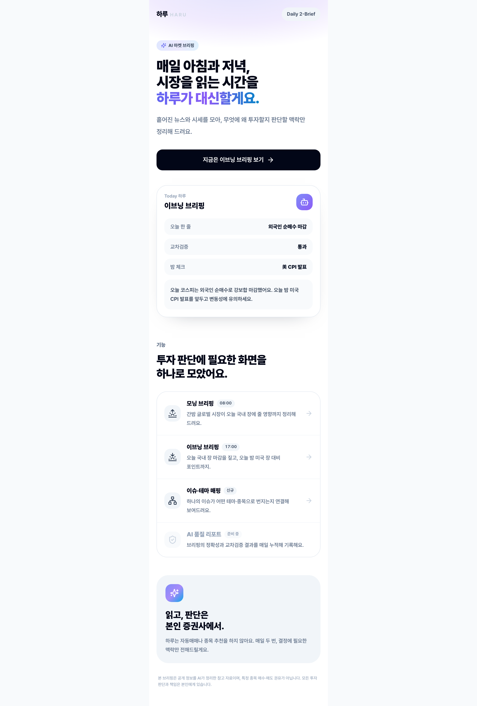
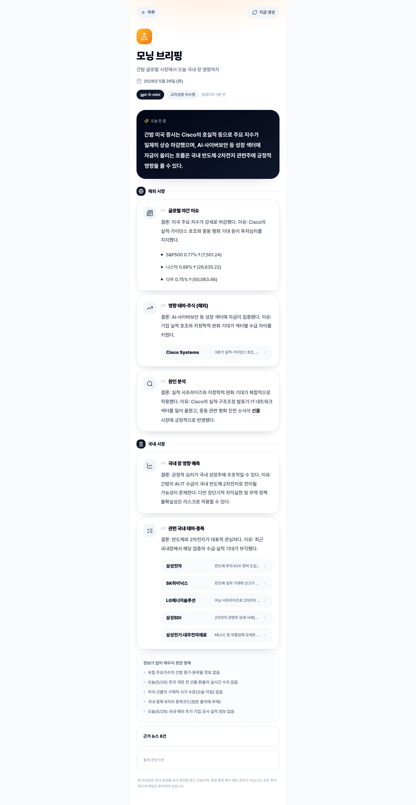
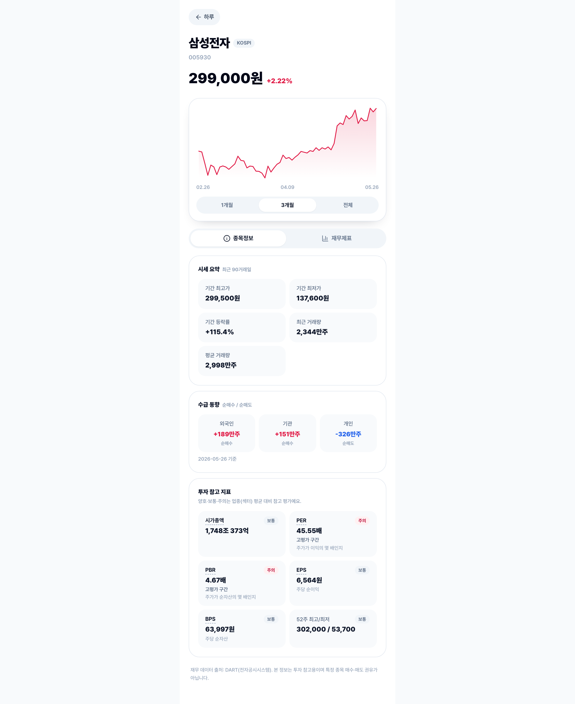
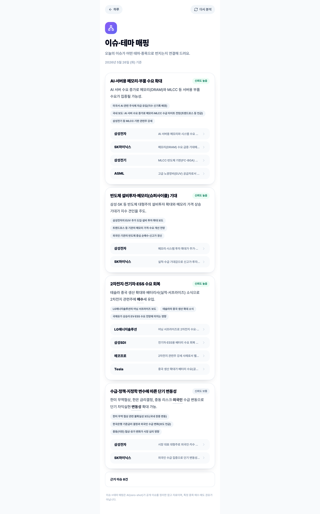
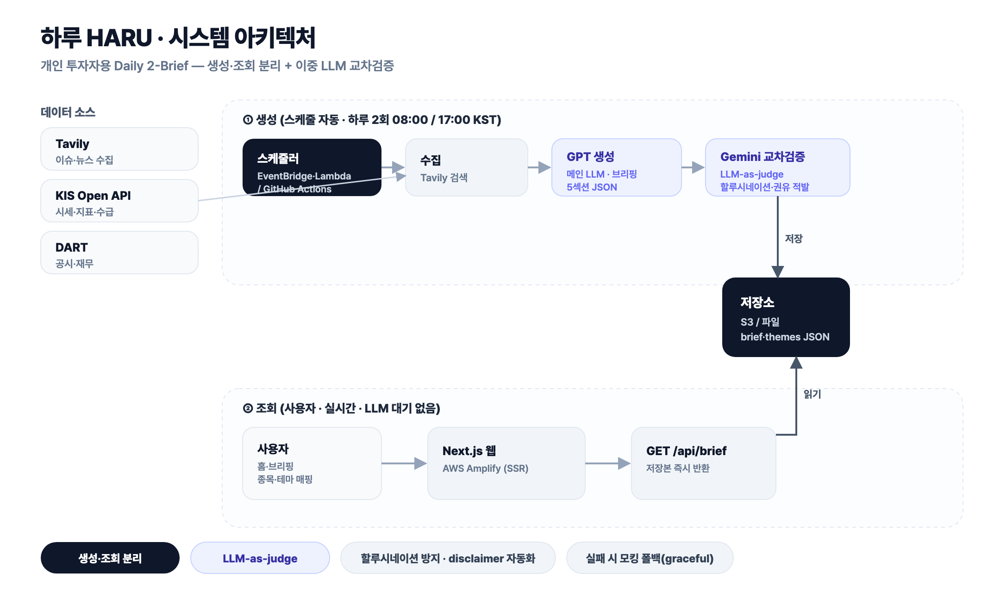

# Haru — Personal Investment Workflow OS

> 개인 투자자의 **리서치 → 결정 → 회고** 워크플로우를 한 곳에서 설계하고 자동화하는 플랫폼.
> Daily 2-Brief로 매일 두 번 시장을 정리하고, 종목 워크북·AI 체크리스트·투자 저널로 결정을 돕습니다.
> 종목을 추천하지 않고 정리만 합니다. 최종 결정은 사용자에게 있습니다.

## 구조

| 디렉터리 | 내용 | 상태 |
|---|---|---|
| [`frontend/`](frontend/) | Next.js 14 App Router. Daily 2-Brief UI, 종목 상세, `/glossary` 용어 도우미 | Amplify SSR 배포 중 |
| [`backend/`](backend/) | FastAPI. Bedrock Knowledge Base + Guardrail RAG, 워크북·체크리스트·저널 API | 로컬 실행 |
| [`.kiro/`](.kiro/) | Spec-Driven Development (steering + `bedrock-kb-and-guardrail` spec) | — |
| [`planning/`](planning/) | sprint 로그, [known-issues](planning/known-issues.md), [metrics](planning/metrics.md), [블로그](planning/blog_harness_roi_1.md) | — |
| `docs/`, `screenshots/` | 아키텍처 다이어그램, 포트폴리오 화면 | — |

## 하이라이트 — Bedrock KB + Guardrail 백엔드

- **AWS Bedrock Knowledge Base**: S3 Vectors 저장소, Titan Embed v2, 투자 용어 302개 색인(302/302). 모델은 Claude Sonnet 4.5 (cross-Region 추론 프로파일).
- **Guardrail**: topic·content Standard tier + cross-Region profile `apac.guardrail.v1:0`, contextual grounding 0.50. 원칙 질문 INPUT 차단 **2/35 → 30/35** (Classic tier 한국어 미지원 발견, KI-023).
- **3층 방어**: 시스템 프롬프트 → Guardrail INPUT/OUTPUT → 코드 후처리(`core/guardrail.py`). 우회 표현 5건이 Guardrail INPUT을 통과하는 한계도 공개(KI-024).
- **품질 실측 (100건, 3차)**: KB 보유 용어 차단 47% → 22%, KB 미보유 용어 거절 86%(원칙 2 "근거 없는 답변 금지" 작동), 쿼리당 $0.0103, p95 13.4s.
- **하네스**: `--dry-run` 기본 + `--apply` 명시 + 외부 호출 전 사람 승인. drift 15건(KI-010~024)을 찾아 수정·등재, 회귀 테스트 239 passed. 전체 이야기는 [블로그](planning/blog_harness_roi_1.md).

---

## Daily 2-Brief (frontend, 운영 중)

> 매일 아침·저녁 두 번, **간밤 글로벌 → 오늘 국내 장** 흐름을 자동 브리핑.
> 메인 LLM (GPT) 이 만든 브리핑을 보조 LLM (Gemini) 이 즉시 교차검증해 hallucination·투자권유 표현을 찾아 화면에 표시한다.

[](https://main.dlz2aim8js0bv.amplifyapp.com)
[](https://main.dlz2aim8js0bv.amplifyapp.com/api/brief?type=morning)
[](LICENSE)

<table>
  <tr>
    <td><a href="screenshots/01_home.png"></a></td>
    <td><a href="screenshots/02_brief_morning.png"></a></td>
  </tr>
  <tr>
    <td align="center"><sub>홈 — 시간대별 자동 전환 (오전 8시 / 오후 5시 기준)</sub></td>
    <td align="center"><sub>모닝 브리핑 — 글로벌 → 국내 영향 → 관련 테마·종목</sub></td>
  </tr>
  <tr>
    <td><a href="screenshots/03_stock_samsung.png"></a></td>
    <td><a href="screenshots/04_themes.png"></a></td>
  </tr>
  <tr>
    <td align="center"><sub>종목 상세 — KIS 시세·수급, DART 재무 실시간</sub></td>
    <td align="center"><sub>이슈·테마 매핑 — 오늘 이슈 → 테마 → 관련 종목</sub></td>
  </tr>
</table>

---

### 핵심 기능

| 기능 | 어떻게 |
| --- | --- |
| **이중 LLM 교차검증** | GPT-5-mini 가 브리핑 생성 → Gemini 2.5-flash 가 hallucination·원본 불일치·투자권유 표현 검증 (LLM-as-judge). 실패 단계는 graceful degradation. |
| **시세·재무 라이브 데이터** | 국내 종목 시세·일봉·수급은 [KIS Open API](https://apiportal.koreainvestment.com/) (PROD), 재무는 [DART](https://opendart.fss.or.kr/) 라이브. 해외·매핑 없는 종목만 데모. |
| **이슈 → 테마 → 종목** | Tavily 검색으로 오늘 이슈 수집 → LLM zero-shot 으로 테마·관련 종목·신뢰도 매핑. 종목 태그 클릭 시 KIS 데이터로 상세 페이지. |
| **하루 2회 자동 스케줄** | AWS EventBridge Scheduler 가 08:00·17:00 KST 에 Lambda 호출 → S3 저장. Amplify SSR 은 S3 에서 읽기만 → 페이지 로드는 LLM 없이 즉시. |
| **금융 가이드라인 준수** | 종목 직접 추천 금지, "당신의 체크리스트에 따른 정보 정리" 표현, 데이터 결측 시 "데모" 표기 + meta.warnings 노출. |

---

### 아키텍처



또는 [SVG 원본](docs/haru_architecture.svg).

**런타임 흐름**

```
EventBridge Scheduler (08:00 / 17:00 KST)
        │
        ▼
AWS Lambda  haru-cron-worker  (nodejs20.x, 1024MB, 600s)
        │   ├─ Tavily ─ 이슈 수집
        │   ├─ GPT-5-mini ─ 브리핑 생성
        │   ├─ Gemini 2.5-flash ─ 교차검증
        │   └─ 테마 매핑
        ▼
S3  haru-store-205474063205
        │
        ▼
Amplify SSR (Next.js 14 App Router)
  ├─ GET /api/brief    ← S3 즉시 반환
  ├─ GET /api/themes   ← S3 즉시 반환
  └─ GET /api/stock/[code]  ← KIS + DART 실시간 호출
```

생성과 조회를 완전히 분리해서 페이지 응답 시간을 LLM 지연과 무관하게 유지합니다.

---

### 기술 스택

- **Frontend / SSR**: Next.js 14 (App Router) · TypeScript · Tailwind · Lucide
- **LLM**: OpenAI GPT-5-mini (메인) · Google Gemini 2.5-flash (교차검증)
- **데이터**: KIS Open API (시세·일봉·수급) · DART (재무) · Tavily (이슈)
- **인프라**: AWS Amplify (SSR Hosting) · AWS Lambda + EventBridge (cron) · S3 (영속 저장)
- **번들링**: esbuild (Lambda) · Next.js (web)

---

### 빠른 실행 (로컬, frontend)

```bash
cd frontend
cp .env.example .env.local         # KIS / DART / OpenAI / Gemini / Tavily 키 채우기
npm install
npm run build:krx                   # KRX 종목코드 매핑 생성 (2,700+ 종목)
npm run dev                         # http://localhost:3000
```

`.env.local` 채우는 키는 [`frontend/README.md`](frontend/README.md) 의 "환경변수" 섹션 참고.

---

## 백엔드 로컬 실행

```bash
cd backend
uv sync
cp .env.example .env    # 필요한 키를 채운다 (비워 두면 KB·DART는 mock 응답)
PYTHONPATH=. uv run uvicorn app.main:app --reload --port 8000
```

- Swagger: http://localhost:8000/docs
- frontend 개발 서버는 `/backend/*` 요청을 `http://localhost:8000/api/v1/*`로 프록시한다(`frontend/next.config.mjs`).
- API·테스트·벤치마크 상세: [`backend/README.md`](backend/README.md)

---

## 레포 구조

```
.
├── frontend/                Next.js 14 App Router · TypeScript · Tailwind
│   ├── app/                 라우트 (page.tsx · api/* · glossary)
│   ├── components/          BriefView · ThemesView · StockDetail · GlossarySearch 등
│   ├── lib/                 pipeline · llm · kis · dart · store · s3 (server-only 가드)
│   ├── scripts/             build-krx.mjs · lambda-handler.ts
│   └── dist/                esbuild 번들 (Lambda 배포용)
├── backend/                 FastAPI · Pydantic v2 · boto3 · structlog
│   ├── app/                 api/v1 · core(guardrail·prompts) · services(rag·hantu_readonly) · models
│   ├── scripts/             kb/ · guardrail/ · bench/ (--dry-run 기본, --apply 명시)
│   └── tests/               unit · integration · regression
├── .kiro/                   steering(product·tech·principles) · specs/bedrock-kb-and-guardrail
├── planning/                known-issues · metrics · testsets · 블로그
├── docs/                    아키텍처 다이어그램 · 핸드오버 문서
├── screenshots/             포트폴리오용 화면 캡처 (1280px · retina)
└── README.md                ← 이 파일
```

---

## 알려진 이슈와 로드맵

- [`planning/known-issues.md`](planning/known-issues.md)에 drift 15건(KI-010~024)을 원인·수정·회귀 테스트와 함께 공개한다. 기존 `/brief`·`/themes` 경로가 Guardrail 밖에 있다는 점(KI-018)도 포함한다.
- 다음 로드맵:
  - Phase 5c: KB 커버리지 확장 (WACC, 우선주, DCF 등 자주 묻는 미보유 용어)
  - Sprint 3: frontend 체감 통합 (StockDetail + 워크북·체크리스트·저널 UI)
  - Phase 6: pre-commit hook, teardown `--scope`, env 베이크인 제거(KI-019)

---

## 운영·배포 메모

- **배포**: `amplify.yml` 자동 인식 → AWS Amplify SSR 으로 푸시 시 자동 빌드
- **Lambda 코드 갱신**: `cd frontend && npm run build:lambda` → `dist/lambda.zip` → `aws lambda update-function-code`
- **수동 트리거**: `aws lambda invoke --function-name haru-cron-worker --payload '{"slot":"morning"}' --cli-binary-format raw-in-base64-out --region ap-northeast-2 out.json`
- **로그**: CloudWatch `/aws/lambda/haru-cron-worker`

자세한 배포 가이드: [`docs/PORTFOLIO_HANDOVER.md`](docs/PORTFOLIO_HANDOVER.md)

---

## 라이선스

[MIT](LICENSE). 시세·재무 데이터는 KIS·DART·공공데이터포털 각 약관을 따릅니다.

---

**Built by 하누 / Hanu ([@westhnu](https://github.com/westhnu))** — AI 콘텐츠 크리에이터 · 인공지능학과 4학년
